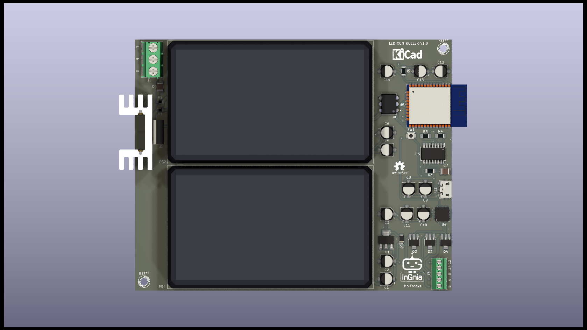

# LED Controller — Earlier Design Exercise

Earlier PCB design exercise combining an ESP32, AC/DC supply modules and LED-control circuitry.

> **Status: unvalidated design exercise.** KiCad files, a PDF schematic and renders are available. No firmware or test results are supplied. The published manufacturing directory contains drill-related files, not a complete released fabrication package.

## Intended architecture

The published component netlist includes:

- **ESP32-WROOM-32** controller.
- **IRM-60-12** and **IRM-60-24** AC/DC supply modules.
- **PCA9685BS** PWM controller.
- **FT232RL** USB-to-UART interface.
- **MOC3021M** optocoupler and **BT136-500** triac.
- **2N7000** devices and **LM1117-3.3** regulation.

The supply-module ratings are component ratings, not validated output capabilities of the assembled board. Scheduling, wireless control, efficiency improvements and dimming performance require firmware and testing and are not demonstrated here.

## Before further development

1. Review mains-related separation, protection, component ratings and enclosure requirements.
2. Verify low-voltage rail loading, signal levels and the proposed LED drive stages.
3. Define load types, channel currents, switching behavior and fault handling.
4. Run ERC/DRC after synchronizing schematic and PCB.
5. Prepare a complete reviewed BOM and fabrication package.
6. Develop firmware and validate a prototype using appropriate safety procedures.

Do not connect the board to mains or send the historical outputs for production based only on this documentation.

## Relationship to later work

The separate [RGB+CCT controller](https://github.com/MbFredys/RGB-LED-and-High-Dencity-CCT-Controller) explores a five-channel architecture with a nominal 12 V input. It is also a design under review, not a validated replacement product.

## Files

| Directory | Purpose |
|---|---|
| [KiCAD files](KiCAD%20files/) | Editable schematic, PCB, project, BOM and netlist |
| [PDF Schematic](PDF%20Schematic/) | PDF circuit documentation |
| [Release](Release/) | Renders |
| [Manufacturing](Manufacturing/) | Partial historical outputs |
| [Firmware](Firmware/) | Availability note; no implementation |

## License

CERN-OHL-W-2.0. See [LICENSE](LICENSE) and [COPYING](COPYING).
